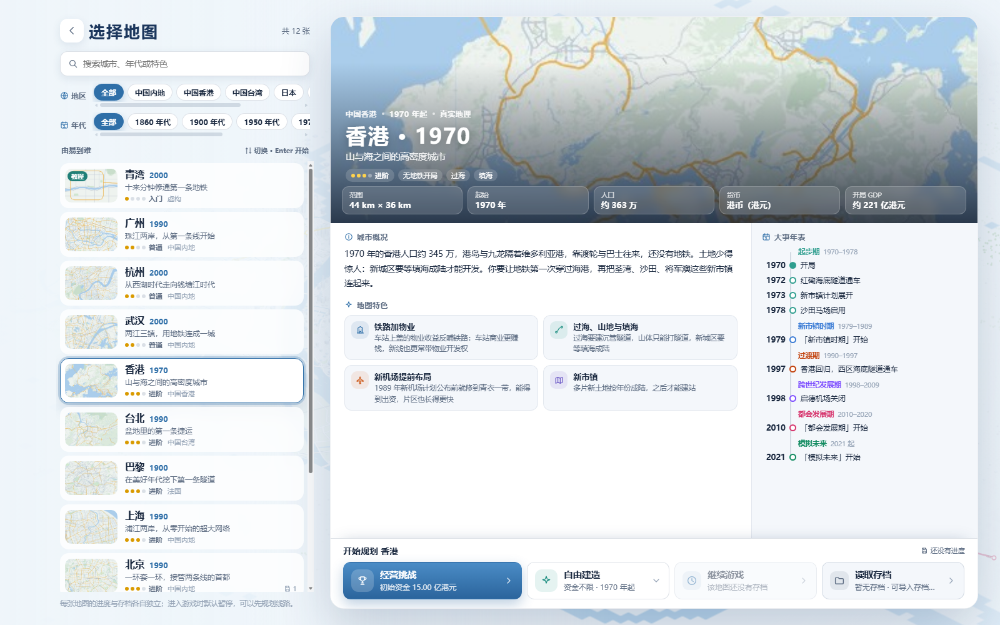
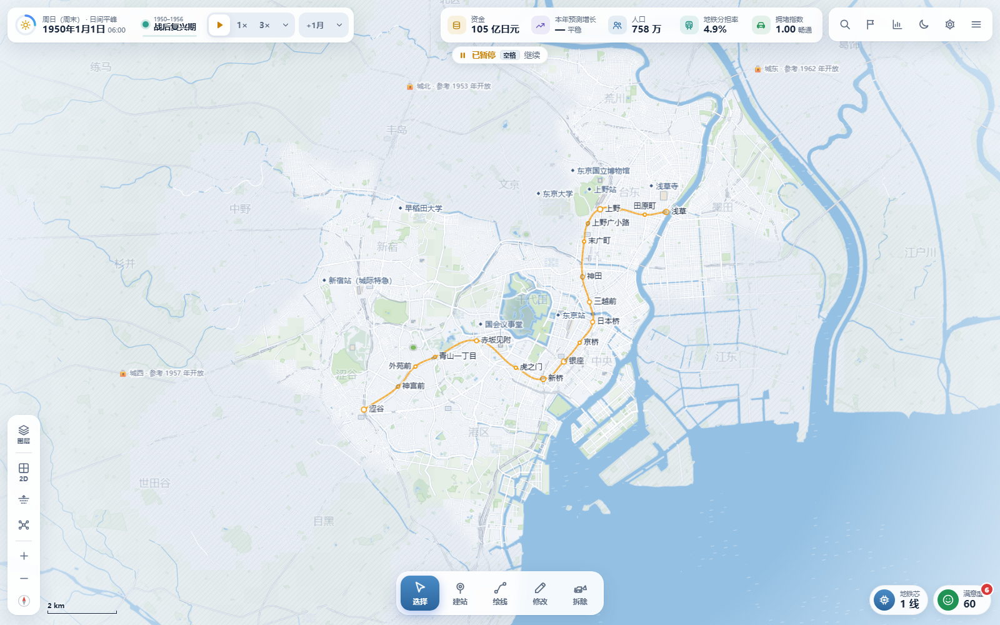
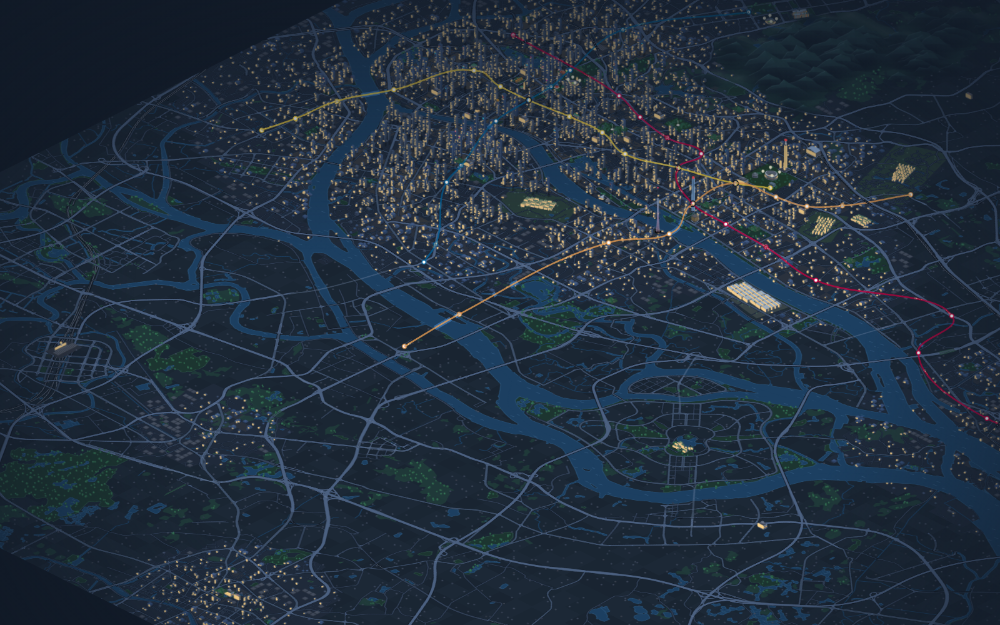
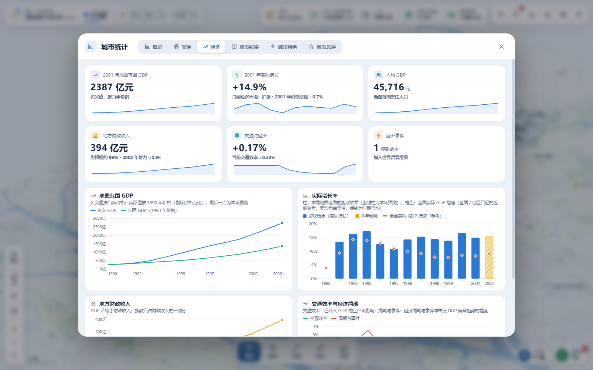

# 城市与地铁

**简体中文** · [繁體中文](./README.zh-TW.md) · [English](./README.en.md)

**在真实城市里，画出你自己的地铁。**

> **Candquarzy 北京地图社区修改版**：新增「北京 · 1990」，支持经营挑战与自由建造。打开本仓库的 `index.html`，选择「开始游戏 → 北京」即可游玩；下方原版网站链接不包含这张新增地图。北京采用自定义空白路网，现实中当时已拥有地铁。范围、数据来源与验证方法见 [北京地图说明](./docs/beijing-map.md)。原作者：[VinsonFung](https://github.com/VinsonFung)，[原始仓库](https://github.com/VinsonFung/city-and-metro)。

《城市与地铁》是一款在浏览器中游玩的单人地铁规划与城市经营游戏。从第一座车站开始，连接住区、商圈、校园与机场，跨过江河，逐步织出自己的交通网络。城市随年代发展，居民也会根据你的路网重新选择出行方式。

**[在线游玩](https://city-and-metro.pages.dev)** · [源码仓库](https://github.com/VinsonFung/city-and-metro) · [使用许可](./LICENSE.txt)

## 维护与社区版本

本仓库会由原作者 **VinsonFung** 持续维护和更新，**请不要向本仓库提交 Pull Request（PR）**。

欢迎在遵守非商业许可的前提下制作社区改版，并自行部署到自己的网站。发布时，请在网站醒目位置标注这是社区修改版，并保留以下署名与链接：

- 原作者：[VinsonFung](https://github.com/VinsonFung)
- 本游戏网站：[城市与地铁](https://city-and-metro.pages.dev)
- 原始仓库：[VinsonFung/city-and-metro](https://github.com/VinsonFung/city-and-metro)

**原版及社区改版均严禁商业使用。** 不得收费游玩、出售、投放广告、接受商业赞助或用于其他商业变现；免费发布、修改或改名不构成例外。请保留原有许可证、版权和第三方署名，清楚说明自己的修改，不要冒充官方版本。

后续会在本游戏网站中汇总并集成大家的社区版链接，方便玩家发现和体验不同版本。谢谢理解与配合。

## 你可以做什么

- **选择城市与年代。** 九座真实城市加一张青湾教程地图，各有地形、发展阶段与本地目标；自由建造还可以选择起始年份、解锁全图。
- **规划自己的路网。** 建设地下、地面和高架线路，设计曲线、环线、支线与分层换乘，调整站台方向，拆分或贯通线路。草案可以预览、撤销，确认后投入运营。
- **经营一座城市的地铁。** 选择无限资金，或在经营挑战中平衡建设、运营、票款、拨款与债务。用客流、拥堵、步行覆盖和建设效果报告判断下一步。
- **跟着城市一起发展。** 新城区、机场、校园和景区随年代启用，历史事件影响出行与经济；完成设施接驳任务，查看阶段总结和城市纪事。地图外机场在边界外显示方向、距离与客流，把线路接到边缘接驳口即可服务。
- **观察路网里的生活。** 在 2D、2.5D 与地下视图中切换，跟随列车进站，观察街头人车、城市地标与夜景。环境音随镜头所在区域变化。

支持简体中文、繁体中文和 English，可在「设置 → 画面 → 界面语言」中切换。桌面与手机均有对应界面，触屏支持拖动和双指缩放。

进入地图时，城市大图作为载入背景，LOGO 沿笔画逐段绘成，车站依次亮起；下方线路进度条显示城市、交通与出行的准备进度，并跟随系统的减少动态效果设置。

## 游戏截图

以下为当前仓库 **v2.2.0** 的实机截图，拍摄于 **2026-10-29**。

### 选择你的城市

九张地图各有简介、城市特色和分阶段年表，地区与年代筛选可左右拖动。下图为香港地图，包含扩展后的离岛与机场范围。



### 东京：从银座线开始

1950 年开局接管浅草—涩谷之间的银座线 18 站，在白天的 2D 地图中观察街区与既有路网。



### 广州：珠江两岸的夜景

2.5D 视图中的建筑、江面、地标与地铁线网。画面来自游戏内 2012 年的主菜单演示场景，已收起界面。



### 从路网看到城市经济

经济统计展示 GDP、增长、地方财政与交通效率。下图使用独立创建的广州自由建造演示进度：2000 年开局建成五站线路，再按正常结算推进两年。图中开局前的数据来自年代推演，数值均为游戏模拟结果。



## 城市与开局

| 地图 | 默认起年 | 规划特色 |
| --- | --- | --- |
| 青湾 | 2000 | 虚构小城，12 步教程，无限资金 |
| 北京 | 1990 | 自定义空白路网，长安街、中关村、奥运场馆、通州与双机场接驳 |
| 广州 | 1990 | 珠江两岸、老城与天河，向番禺和大学城发展 |
| 杭州 | 2000 | 西湖、钱塘江、跨江新城与萧山机场 |
| 香港 | 1970 | 山地海港、新市镇、填海与赤鱲角机场 |
| 台北 | 1990 | 盆地、三河与多中心发展 |
| 东京 | 1950 | 接手银座线 18 站，连接副都心与羽田机场 |
| 上海 | 1990 | 黄浦江、浦东开发、世博会与迪士尼 |
| 武汉 | 2000 | 两江三镇、东湖、光谷与天河机场 |
| 巴黎 | 1900 | 百年城市变迁、跨城通勤与两大机场 |

九座真实城市均支持经营挑战与自由建造，使用对应城市和年代的货币、票价及经营参数。后来的真实地铁不会自动出现，线路由你规划。

## 运行与存档

打开[游戏网站](https://city-and-metro.pages.dev)即可游玩。也可以下载本仓库，在桌面版 Chrome、Edge 或 Firefox 中打开 `index.html`，无需安装依赖或构建。

进度和设置保存在当前浏览器，无需账号。支持自动保存、手动保存、存档改名，以及 JSON 导入导出。更换电脑、浏览器或网址前，请先导出备份。未确认的建设草案不会保存。

支持的旧存档会在升级前保留原始备份，已有站线、票制、资金、债务和历史账目继续保留。载入失败时，可在存档列表导出原始数据。

## 常用操作

按键可在「设置 → 键位」中修改，游戏内提示会同步更新。

| 操作 | 默认方式 |
| --- | --- |
| 平移 / 缩放 | 左键拖动、WASD / 方向键；滚轮、`+` / `−` |
| 工具 | `V` 选择 · `B` 建站 · `L` 绘线 · `E` 修改 · `X` 拆除 |
| 绘线 | 依次点击；`Shift` + 点击添加转弯点；右键 / `Enter` 结束 |
| 草案 | `Ctrl+Z` 撤销 · `Ctrl+Y` 重做 · `Ctrl+Enter` 确认建设 |
| 时间 | `空格` 暂停 / 继续；`1` / `2` / `3` / `4` 切换速度；`.` 推进一月 |
| 视图 | `T` 切换 2D / 2.5D · `U` 地下 · `K` 线网图 · `F` 全图 |
| 常用入口 | `/` 搜索 · `J` 任务 · `G` 统计 · `Ctrl+S` 保存 · `F10` 设置 |
| 帮助 / 菜单 | `F1` 操作说明；`Esc` 暂停并打开菜单，弹窗内优先取消 / 返回 |

## 本地开发与部署

使用原生 HTML、CSS 和 JavaScript。玩法与验收要求见 [PRD](./PRD.md)，玩家更新公告见 [js/news.js](./js/news.js)。

使用 Node.js 构建，生成的 `dist/` 可部署到静态网站托管服务；社区部署须遵守上面的署名与非商业要求。

```sh
node scripts/build.mjs
node scripts/verify-game.mjs --dist
```

回归检查：

```sh
node scripts/test-map-migrations.mjs
node scripts/test-v22.mjs
node scripts/test-web-sync.mjs
node scripts/test-beijing.mjs
```

## 版权与许可

**Copyright © 2026 VinsonFung。保留所有权利，严禁商业使用。**

非商业学习、研究、游玩、修改及分享须遵守 [LICENSE.txt](./LICENSE.txt)。第三方代码、数据与资源保留各自许可；OpenStreetMap 地理数据遵循 ODbL 1.0，详见[第三方声明](./THIRD_PARTY_NOTICES.txt)。
