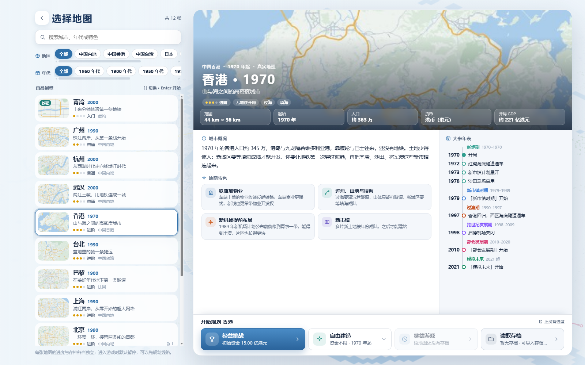
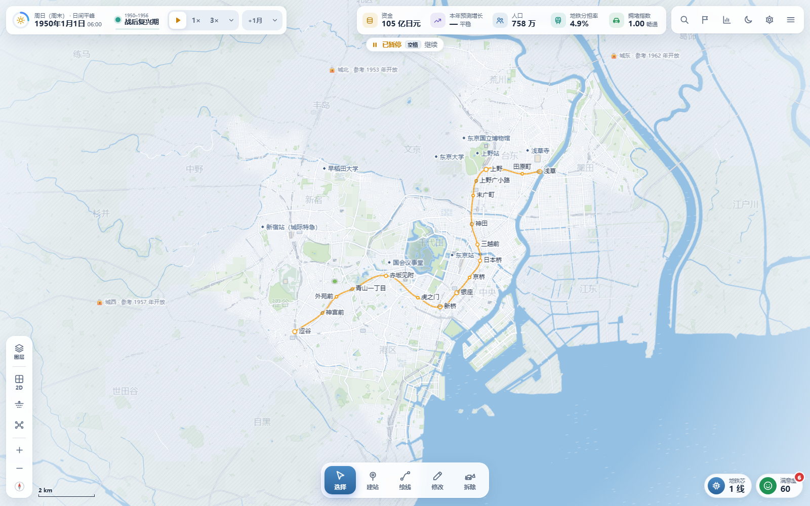
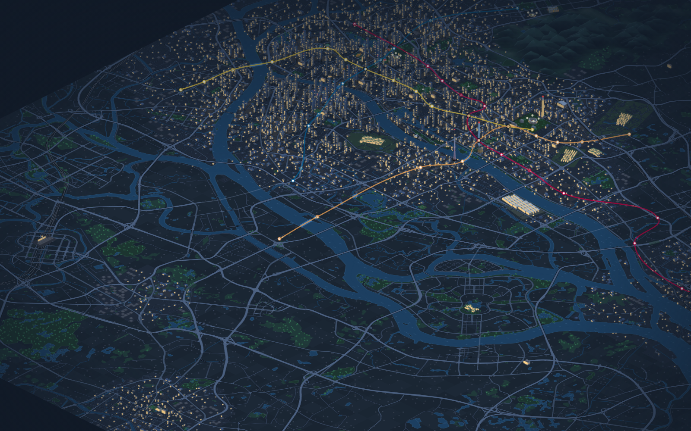
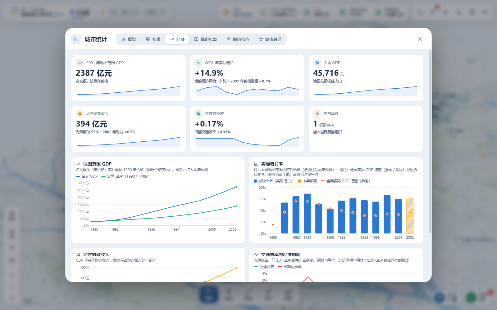

# 城市與地鐵

> **Candquarzy 北京地圖社群修改版**：新增「北京 · 1990」，支援經營挑戰與自由建造。開啟本倉庫的 `index.html`，選擇「開始遊戲 → 北京」即可遊玩；原版網站不包含新增地圖。本場景採用自訂空白路網，現實中當時北京已擁有地鐵。詳見[北京地圖說明](./docs/beijing-map.md)。原作者：[VinsonFung](https://github.com/VinsonFung)；[原始倉庫](https://github.com/VinsonFung/city-and-metro)。

[简体中文](./README.md) · **繁體中文** · [English](./README.en.md)

**在真實城市裡，畫出你自己的地鐵。**

《城市與地鐵》是一款在瀏覽器中遊玩的單人地鐵規劃與城市經營遊戲。從第一座車站開始，連接住宅區、商圈、校園與機場，跨過江河，逐步織出自己的交通網路。城市隨年代發展，居民也會根據你的路網重新選擇出行方式。

**[線上遊玩](https://city-and-metro.pages.dev)** · [原始碼儲存庫](https://github.com/VinsonFung/city-and-metro) · [使用許可](./LICENSE.txt)

## 維護與社群版本

本儲存庫會由原作者 **VinsonFung** 持續維護和更新，**請不要向本儲存庫提交 Pull Request（PR）**。

歡迎在遵守非商業許可的前提下製作社群改版，並自行部署至自己的網站。發布時，請在網站醒目位置標註這是社群修改版，並保留以下署名與連結：

- 原作者：[VinsonFung](https://github.com/VinsonFung)
- 本遊戲網站：[城市與地鐵](https://city-and-metro.pages.dev)
- 原始儲存庫：[VinsonFung/city-and-metro](https://github.com/VinsonFung/city-and-metro)

**原版及社群改版均嚴禁商業使用。** 不得收費遊玩、販售、投放廣告、接受商業贊助或用於其他商業變現；免費發布、修改或改名不構成例外。請保留原有授權條款、版權和第三方署名，清楚說明自己的修改，不要冒充官方版本。

後續會在本遊戲網站中彙整並整合大家的社群版連結，方便玩家發現和體驗不同版本。謝謝理解與配合。

## 你可以做什麼

- **選擇城市與年代。** 九座真實城市加一張青灣教學地圖，各有地形、發展階段與本地目標；自由建造還可以選擇起始年份、解鎖全圖。
- **規劃自己的路網。** 建設地下、地面和高架路線，設計曲線、環線、支線與分層轉乘，調整月台方向，拆分或貫通路線。草案可以預覽、復原，確認後投入營運。
- **經營一座城市的地鐵。** 選擇無限資金，或在經營挑戰中平衡建設、營運、票款、撥款與債務。透過客流、壅塞、步行覆蓋和建設效果報告判斷下一步。
- **跟著城市一起發展。** 新城區、機場、校園和景區隨年代啟用，歷史事件影響出行與經濟；完成設施接駁任務，查看階段總結和城市紀事。地圖外機場在邊界外顯示方向、距離與客流，將路線接到邊緣接駁口即可服務。
- **觀察路網裡的生活。** 在 2D、2.5D 與地下視圖中切換，跟隨列車進站，觀察街頭人車、城市地標與夜景。環境音隨鏡頭所在區域變化。

支援簡體中文、繁體中文和 English，可在「設定 → 畫面 → 介面語言」中切換。桌面與手機均有對應介面，觸控支援拖曳和雙指縮放。

進入地圖時，城市大圖作為載入背景，LOGO 沿筆畫逐段繪成，車站依序亮起；下方路線進度條顯示城市、交通與出行的準備進度，並遵循系統的減少動態效果設定。

## 遊戲截圖

以下為目前儲存庫 **v2.2.0** 的實機截圖，拍攝於 **2026-10-29**。

### 選擇你的城市

九張地圖各有簡介、城市特色和分階段年表，地區與年代篩選可左右拖曳。下圖為香港地圖，包含擴展後的離島與機場範圍。



### 東京：從銀座線開始

1950 年開局接管淺草—澀谷之間的銀座線 18 站，在白天的 2D 地圖中觀察街區與既有路網。



### 廣州：珠江兩岸的夜景

2.5D 視圖中的建築、江面、地標與地鐵路網。畫面來自遊戲內 2012 年的主選單示範場景，已收起介面。



### 從路網看到城市經濟

經濟統計展示 GDP、成長、地方財政與交通效率。下圖使用獨立建立的廣州自由建造示範進度：2000 年開局建成五站路線，再依正常結算推進兩年。圖中開局前的資料來自年代推演，數值均為遊戲模擬結果。



## 城市與開局

| 地圖 | 預設起年 | 規劃特色 |
| --- | --- | --- |
| 青灣 | 2000 | 虛構小城，12 步教學，無限資金 |
| 北京 | 1990 | 自訂空白路網，長安街、中關村、奧運場館、通州與雙機場接駁 |
| 廣州 | 1990 | 珠江兩岸、老城與天河，向番禺和大學城發展 |
| 杭州 | 2000 | 西湖、錢塘江、跨江新城與蕭山機場 |
| 香港 | 1970 | 山地海港、新市鎮、填海與赤鱲角機場 |
| 台北 | 1990 | 盆地、三河與多中心發展 |
| 東京 | 1950 | 接手銀座線 18 站，連接副都心與羽田機場 |
| 上海 | 1990 | 黃浦江、浦東開發、世博會與迪士尼 |
| 武漢 | 2000 | 兩江三鎮、東湖、光谷與天河機場 |
| 巴黎 | 1900 | 百年城市變遷、跨城通勤與兩大機場 |

九座真實城市均支援經營挑戰與自由建造，使用對應城市和年代的貨幣、票價及經營參數。後來的真實地鐵不會自動出現，路線由你規劃。

## 執行與存檔

開啟[遊戲網站](https://city-and-metro.pages.dev)即可遊玩。也可以下載本儲存庫，在桌面版 Chrome、Edge 或 Firefox 中開啟 `index.html`，無需安裝相依套件或建置。

進度和設定儲存在目前瀏覽器，無需帳號。支援自動儲存、手動儲存、存檔重新命名，以及 JSON 匯入匯出。更換電腦、瀏覽器或網址前，請先匯出備份。未確認的建設草案不會儲存。

支援的舊存檔會在升級前保留原始備份，既有站線、票制、資金、債務和歷史帳目繼續保留。載入失敗時，可在存檔清單匯出原始資料。

## 常用操作

按鍵可在「設定 → 按鍵」中修改，遊戲內提示會同步更新。

| 操作 | 預設方式 |
| --- | --- |
| 平移／縮放 | 滑鼠左鍵拖曳、WASD／方向鍵；滾輪、`+`／`−` |
| 工具 | `V` 選取 · `B` 建站 · `L` 繪線 · `E` 修改 · `X` 拆除 |
| 繪線 | 依序點選；`Shift` + 點選新增轉彎點；滑鼠右鍵／`Enter` 結束 |
| 草案 | `Ctrl+Z` 復原 · `Ctrl+Y` 重做 · `Ctrl+Enter` 確認建設 |
| 時間 | `空白鍵` 暫停／繼續；`1`／`2`／`3`／`4` 切換速度；`.` 推進一月 |
| 視圖 | `T` 切換 2D／2.5D · `U` 地下 · `K` 路網圖 · `F` 全圖 |
| 常用入口 | `/` 搜尋 · `J` 任務 · `G` 統計 · `Ctrl+S` 儲存 · `F10` 設定 |
| 說明／選單 | `F1` 操作說明；`Esc` 暫停並開啟選單，彈出視窗內優先取消／返回 |

## 本機開發與部署

使用原生 HTML、CSS 和 JavaScript。玩法與驗收要求見 [PRD](./PRD.md)，玩家更新公告見 [js/news.js](./js/news.js)。

使用 Node.js 建置，產生的 `dist/` 可部署至靜態網站託管服務；社群部署須遵守上面的署名與非商業要求。

```sh
node scripts/build.mjs
node scripts/verify-game.mjs --dist
```

回歸檢查：

```sh
node scripts/test-map-migrations.mjs
node scripts/test-v22.mjs
node scripts/test-web-sync.mjs
```

## 版權與許可

**Copyright © 2026 VinsonFung。保留所有權利，嚴禁商業使用。**

非商業學習、研究、遊玩、修改及分享須遵守 [LICENSE.txt](./LICENSE.txt)。第三方程式碼、資料與資源保留各自授權條款；OpenStreetMap 地理資料遵循 ODbL 1.0，詳見[第三方聲明](./THIRD_PARTY_NOTICES.txt)。
